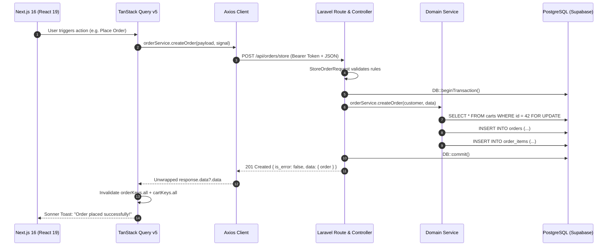

# Full-Stack Architecture & System Contracts

> **The definitive full-stack bridge linking the Laravel backend API with the Next.js presentation tier.**

---

## 1. Monorepo Topology

```
Tomato Root/
├── backend/                             # Laravel 12 API (PHP 8.4, PostgreSQL, Sanctum)
│   ├── app/Services/                   # Flat Domain Services (Pure business logic)
│   ├── app/Http/Controllers/           # Ultra-thin Controllers (Transaction boundaries)
│   ├── routes/api.php                  # Strict 2-Verb HTTP Routes
│   └── laravel-engineering-handbook/   # Canonical Backend Rulebook
│
├── frontend/                            # Next.js 16 (React 19, Pure JS, Tailwind CSS v4)
│   ├── src/app/                        # Next.js App Router (RSC Pages, Skeletons)
│   ├── src/components/                 # Feature Containers & shadcn/ui Primitives
│   ├── src/lib/hooks/                  # TanStack Query Hooks (TkDodo featureKeys)
│   ├── src/services/                   # Axios API Transport Services (AbortSignal)
│   └── nextjs-engineering-handbook/    # Canonical Frontend Rulebook
│
├── AGENTS.md                            # Primary AI Coding Agent Entry Point
├── ARCHITECTURE.md                      # This Full-Stack System Bridge
└── PROJECT_REQUIREMENTS.md              # Active Business Specifications & User Stories
```

---

## 2. The Four Full-Stack Contracts

Communication across the HTTP boundary is governed by four immutable contracts:

### Contract 1: Strict 2-Verb HTTP Routing
Outbound communication between Next.js and Laravel uses **`GET`** and **`POST`** exclusively. `PUT`, `PATCH`, and `DELETE` are strictly forbidden:

| Operation | Approved Verb | Endpoint Pattern |
| :--- | :--- | :--- |
| **Fetch Collection / Details** | `GET` | `/<feature>` or `/<feature>/{id}` |
| **Create Resource** | `POST` | `/<feature>/store` |
| **Update Resource** | `POST` | `/<feature>/{id}/update` |
| **Destroy Resource** | `POST` | `/<feature>/{id}/destroy` |
| **State Machine Action** | `POST` | `/<feature>/{id}/<action>` (e.g. `/orders/{id}/cancel`) |

---

### Contract 2: The ADR-001 Response Envelope
Every response from Laravel is guaranteed to follow the ADR-001 JSON schema:

```json
{
  "is_error": false,
  "message": "Resource retrieved successfully.",
  "data": { ... },
  "errors": {}
}
```

* **Frontend Unwrapping Standard:** Tier 5 service functions (`src/services/<feature>Service.js`) unwrap and return **`response.data?.data ?? null`**.
* **Invariant:** UI components and TanStack Query caches deal exclusively with clean domain data. The outer `{ is_error, message, data, errors }` wrapper is never leaked into React state.

---

### Contract 3: Automated 422 Error Bag Mapping
When Laravel validation fails (`422 Unprocessable Content`), errors return as:
```json
{
  "is_error": true,
  "message": "The given data was invalid.",
  "data": null,
  "errors": {
    "field_name": ["Specific validation error message."]
  }
}
```

* **Frontend Mapping:** The frontend utility `mapLaravelErrorsToForm(parsed.errors, form.setError)` automatically binds backend error messages to matching React Hook Form inputs with zero boilerplate.

---

### Contract 4: Authentication & Bearer Token Flow
* **Issuance:** On successful customer or owner login (`POST /api/auth/login`), Laravel Sanctum returns an API Bearer token.
* **Storage:** Token is stored on the client under `localStorage.getItem('access_token')`.
* **Transport:** The centralized Axios request interceptor (`src/lib/api/api.js`) automatically attaches `Authorization: Bearer <token>` to all outbound requests.
* **Protection:** Protected Next.js pages are wrapped in `<AuthGuard>` to verify tokens before mounting private feature containers.

---

## 3. Full-Stack Data Flow



---

## 4. Canonical Handbook References
* **Backend Master Rulebook:** [`backend/laravel-engineering-handbook/GUIDELINES.md`](backend/laravel-engineering-handbook/GUIDELINES.md)
* **Frontend Master Rulebook:** [`frontend/nextjs-engineering-handbook/GUIDELINES.md`](frontend/nextjs-engineering-handbook/GUIDELINES.md)
* **AI Agent Instructions:** [`AGENTS.md`](AGENTS.md)
* **Product Requirements:** [`PROJECT_REQUIREMENTS.md`](PROJECT_REQUIREMENTS.md)
