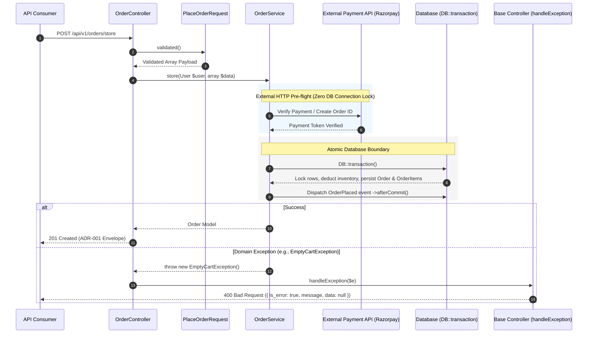

# Module 04 — Business Logic & Domain Architecture

> **The authoritative standard for designing decoupled domain services, atomic transaction boundaries, and the domain exception hierarchy.**

---

## 1. Module Overview

The business logic layer is the core of any enterprise Laravel application. While controllers coordinate HTTP transport and Eloquent models handle data persistence, **the service layer owns business invariants, domain calculations, transactional boundaries, and external provider orchestration**.

This module establishes strict structural rules to ensure domain logic remains:
1. **Decoupled:** Callable from HTTP controllers, Artisan CLI commands, Queue workers, and AI MCP endpoints without HTTP or session dependencies.
2. **Atomic:** Multi-table mutations are wrapped in database transactions with zero external network latency inside transaction blocks.
3. **Resilient:** Errors are communicated via structured, typed domain exceptions that map cleanly to HTTP status codes without leaking internal database details.

---

## 2. Request & Execution Lifecycle

---

## 3. Module Index

| Document | Purpose | Key Standards |
| :--- | :--- | :--- |
| **[`01-service-layer-design.md`](01-service-layer-design.md)** | Service class architecture | Pure `app/Services/`, explicit `User $user` injection, concrete DI, atomic transactions, external latency boundaries, and queue `afterCommit` hooks. |
| **[`02-exception-architecture.md`](02-exception-architecture.md)** | Domain exception hierarchy | Categorized exceptions in `app/Exceptions/<Domain>/`, status code inheritance, controller-level `try/catch` delegation to `BaseController::handleException()`, and database sanitization. |

---

## 4. Architectural Boundaries at a Glance

* **Allowed in Services:** Database transactions, business calculations, dispatching events with `->afterCommit()`, throwing domain exceptions, calling external API clients via injected concrete services.
* **Strictly Forbidden in Services:** Calling `Auth::user()` directly (always accept `User $user` parameter), accessing `request()` or session helpers, making external HTTP calls *inside* `DB::transaction()`, and returning `JsonResponse` objects (services must return Models, Collections, or DTO-arrays).
